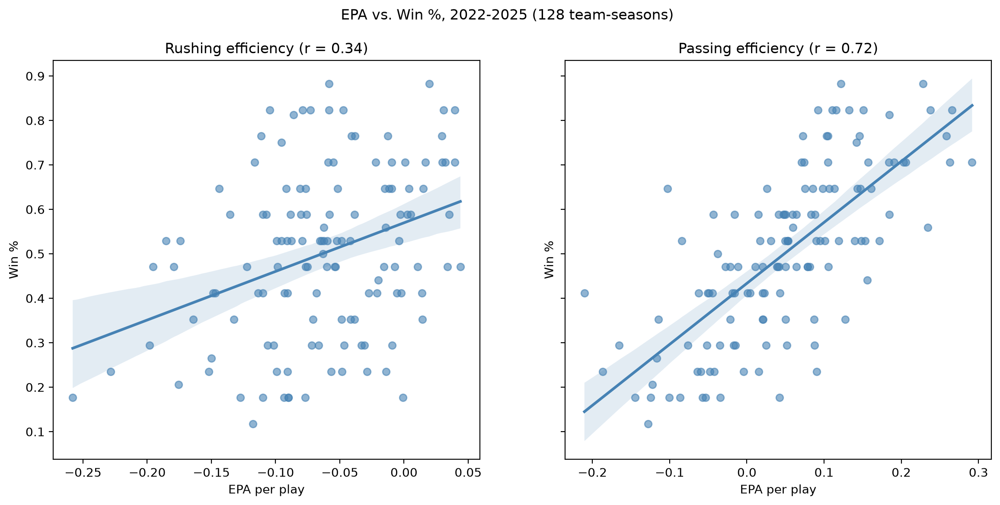
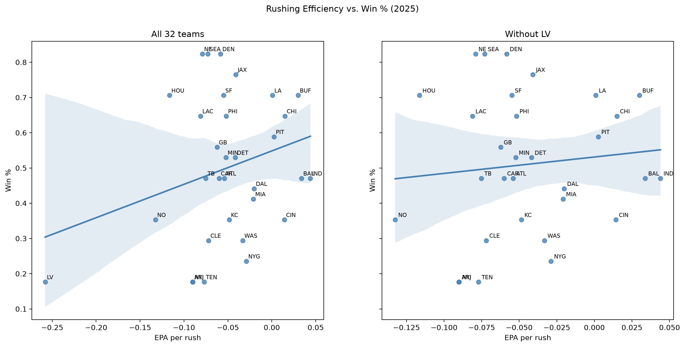
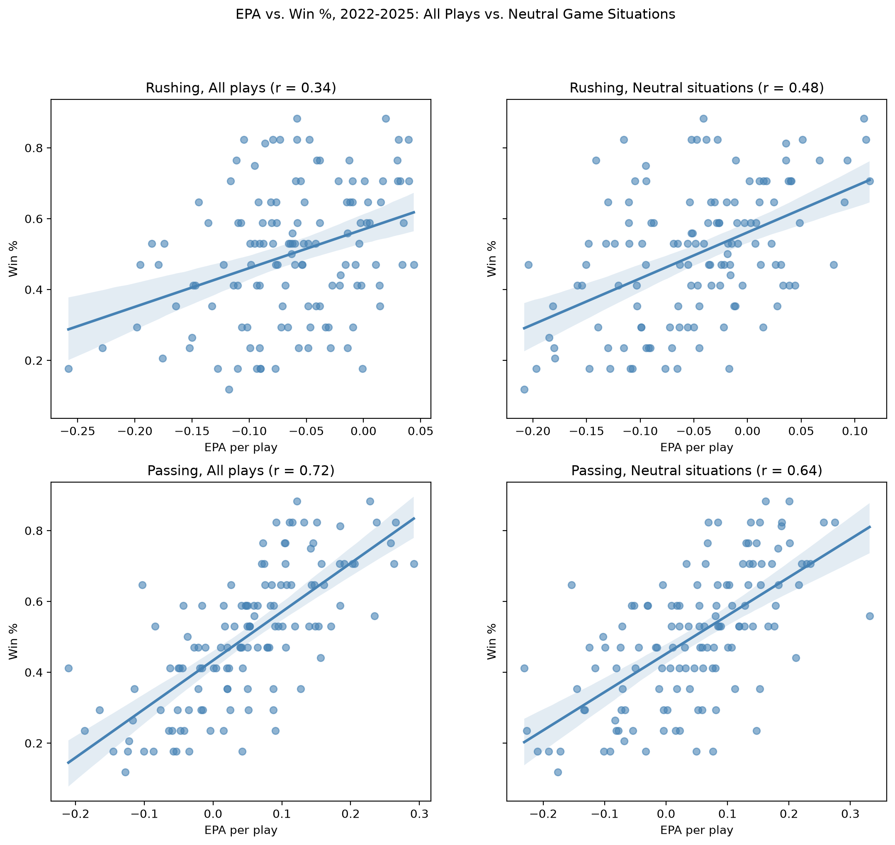
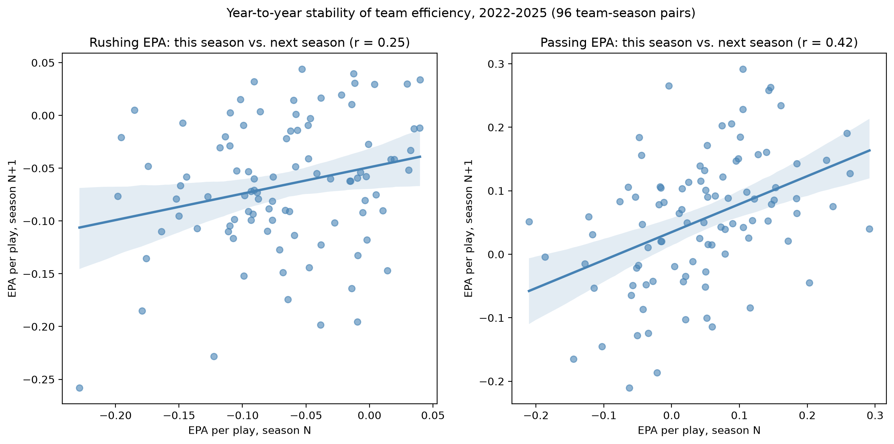

# Does Rushing Efficiency Predict Winning in the NFL?

## Question
How closely is a team's efficiency at running the ball related to its win percentage, and how does that compare with passing efficiency?

## Key finding
Across the 2022-2025 regular seasons (128 team-seasons), **passing efficiency was strongly associated with win percentage (r = 0.72, about 52% of the variance), while rushing efficiency showed a modest relationship (r = 0.34, about 12%).** Passing was the stronger predictor in every individual season.

| Season | Rushing EPA vs. win % (r) | Passing EPA vs. win % (r) |
|---|---|---|
| 2022 | 0.22 | 0.83 |
| 2023 | 0.41 | 0.71 |
| 2024 | 0.49 | 0.79 |
| 2025 | 0.27 | 0.65 |
| All four seasons | 0.34 | 0.72 |

Rushing and passing efficiency were only moderately related to each other (r = 0.42), so a team can be strong at one and weak at the other. In 2025, for example, Indianapolis and Baltimore had the league's best rushing efficiency but finished near .500, while New England, Seattle and Denver won over 80% of their games with below-average rushing efficiency.

## A sensitivity check
In the 2025 season alone, the rushing relationship (r = 0.27) was driven largely by one outlier. With Las Vegas removed, it dropped to r = 0.10. This is a reminder that a single extreme team can create the look of a trend in a 32-team sample.

## Follow-up: controlling for game situation
[`notebooks/02_neutral_game_script_rushing.ipynb`](notebooks/02_neutral_game_script_rushing.ipynb) repeats the analysis using only neutral game situations (win probability 20-80%, more than two minutes left in the half, no overtime), which keeps 56% of all plays. Rushing's correlation with win percentage rose from r = 0.35 to r = 0.48, while passing's fell from r = 0.72 to r = 0.64. Passing remains the stronger predictor, but the gap narrows considerably. The rushing result held across alternative cutoffs (r = 0.47 to 0.49).

## Follow-up: is efficiency repeatable?
[`notebooks/03_year_over_year_stability.ipynb`](notebooks/03_year_over_year_stability.ipynb) asks whether a team's efficiency carries over from one season to the next (96 season pairs, 2022-2025). Passing EPA was more stable than rushing EPA (r = 0.42 vs. 0.25), and last season's passing EPA predicted next season's win percentage about as well as last season's record did (r = 0.36 vs. 0.32), while rushing EPA was a weak predictor (r = 0.12). Filtering to neutral game situations did not improve stability for either metric, likely because it shrinks the sample of plays per team.

## Data
Play-by-play data from [nflverse](https://github.com/nflverse), loaded with the `nflreadpy` Python package. Regular season only. QB scrambles are excluded from rushing plays.

## Method
- Calculated EPA (expected points added) per rush and per pass for each team in each season
- Merged with win percentage computed from game results (ties count as half a win)
- Compared Pearson correlations overall and by season, and tested sensitivity to outliers

## Limitations
- **Correlation is not causation.** Teams that are ahead tend to run more late in games, so part of rushing's link to winning may reflect game situation, not the rushing itself.
- Game script is not controlled for in this analysis; garbage-time plays are included. See the follow-up analysis above, which addresses this.
- Team-seasons from the same franchise are not fully independent, and four seasons is still a small sample.
- Win percentage is influenced by defense, special teams, turnovers and luck, none of which are modeled here.

## Next steps
- Split rushing efficiency by run direction and gap
- Build a model that predicts the success of individual rushing plays
- Build an interactive dashboard of team run-game scouting reports

## How to run
Open [`notebooks/team_rushing_efficieny.ipynb`](notebooks/team_rushing_efficieny.ipynb) and [`notebooks/02_neutral_game_script_rushing.ipynb`](notebooks/02_neutral_game_script_rushing.ipynb) in Jupyter and run all cells. Requires Python 3.10+ and the packages `nflreadpy`, `pandas`, `matplotlib`, `seaborn` and `pyarrow`.
